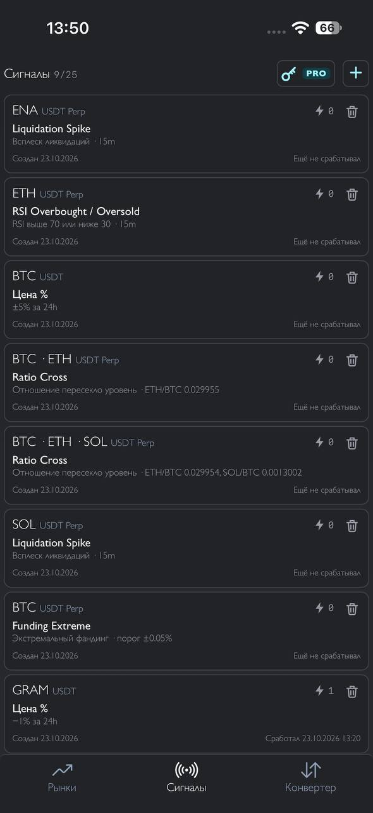
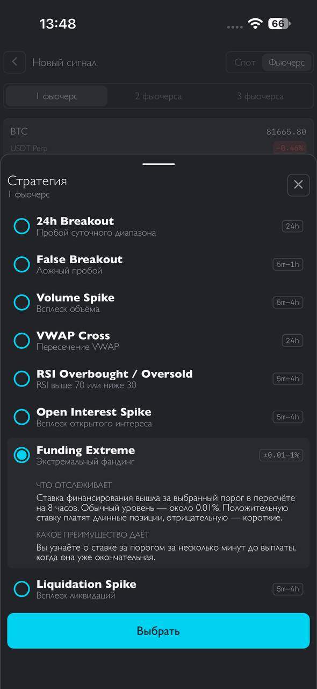
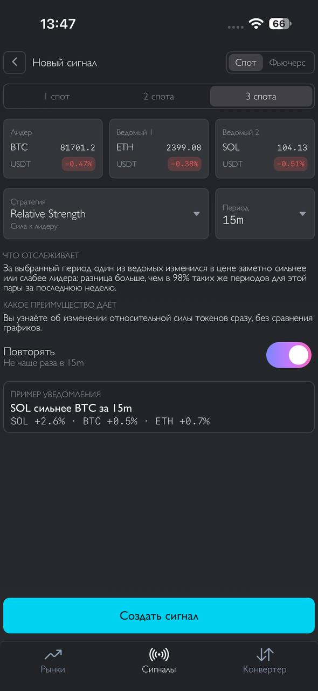
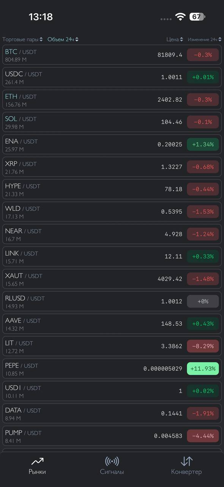
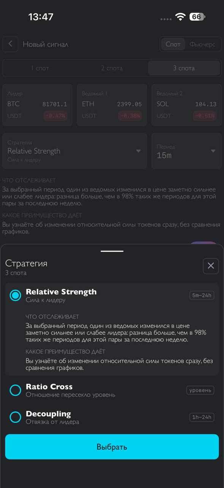
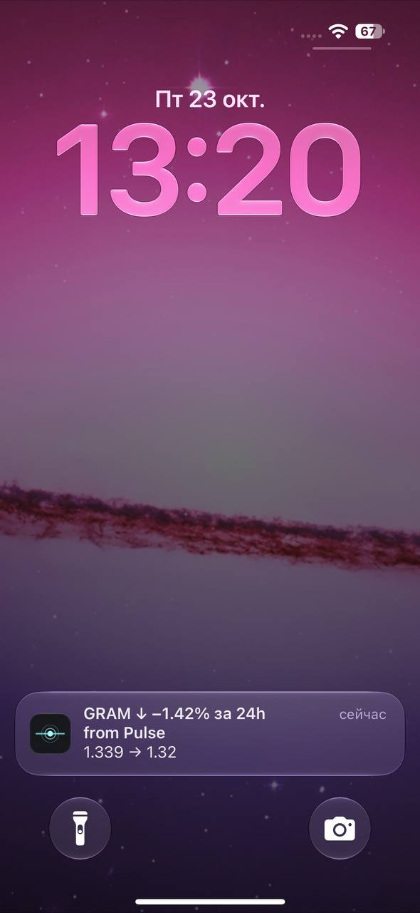

<p align="center">
  
</p>

<h1 align="center">Pulse</h1>
<p align="center">by INPHINIT</p>

<h3 align="center">Отслеживание рынка криптовалют</h3>
<p align="center">Цена, пробои, RSI, объём, фандинг и ликвидации по данным ByBit</p>
<p align="center"><sub>Без регистрации · Без трекеров</sub></p>

<p align="center">
  <a href="https://pulse.inphinit.space"><b>Открыть приложение</b></a> ·
  <a href="https://getpulse.inphinit.space">Сайт</a> ·
  <a href="https://getpulse.inphinit.space/faq.html">Вопросы и ответы</a> ·
  <a href="https://t.me/inphinit_pulse">@inphinit_pulse</a> ·
  <a href="https://t.me/inphinit_pulse_live">@inphinit_pulse_live</a>
</p>

<p align="center">
  <a href="LICENSE"></a>
  
  
  
  
</p>

Исходный код приложения Pulse.

Pulse только сообщает о событиях на рынке. Торговли, подключения кошелька или биржевого аккаунта в нём нет, API-ключи биржи не нужны.

## Скриншоты

<table>
  <tr>
    <td align="center"><br><sub>Сигналы</sub></td>
    <td align="center"><br><sub>Стратегия</sub></td>
    <td align="center"><br><sub>Связка</sub></td>
  </tr>
  <tr>
    <td align="center"><br><sub>Рынки</sub></td>
    <td align="center"><br><sub>Стратегия связки</sub></td>
    <td align="center"><br><sub>Уведомление</sub></td>
  </tr>
</table>

## Почему Pulse

<table>
  <tr>
    <td width="50%" valign="top">
      <b>Без регистрации</b><br>
      Не нужны email, телефон и пароль. Для PRO выдаётся ключ: он заменяет аккаунт и работает на одном устройстве.
    </td>
    <td width="50%" valign="top">
      <b>Без трекеров</b><br>
      На сайте и в приложении нет счётчиков посещений, рекламы и сторонних скриптов.
    </td>
  </tr>
  <tr>
    <td width="50%" valign="top">
      <b>Персональные данные не храним</b><br>
      Имени, email и телефона у нас нет. Сервис не записывает IP-адреса, ключ хранит только в виде хэша, данные плательщика из банка не сохраняет.
    </td>
    <td width="50%" valign="top">
      <b>Оплата без телефона и email</b><br>
      Для оплаты через СБП Pulse не спрашивает телефон и email: счёт оплачивается в приложении вашего банка, кассовый чек доступен в Pulse.
    </td>
  </tr>
  <tr>
    <td width="50%" valign="top">
      <b>Для любой платформы</b><br>
      Pulse устанавливается из браузера на телефон, планшет и компьютер — iPhone, iPad, Android, Mac и Windows.
    </td>
    <td width="50%" valign="top">
      <b>Лёгкое и быстрое</b><br>
      Приложение весит меньше 300 кБ: быстро загружается и почти не занимает места на устройстве.
    </td>
  </tr>
</table>

## Что отслеживает

Топ-50 токенов ByBit по обороту — спот и фьючерсы USDT.

**[Цена](https://getpulse.inphinit.space/strategies/price.html)** · **[Цена %](https://getpulse.inphinit.space/strategies/price-percent.html)**

<table>
  <tr>
    <td><b>Спот</b></td>
    <td>
      <a href="https://getpulse.inphinit.space/strategies/24h-breakout.html">Пробой суточного диапазона</a> ·
      <a href="https://getpulse.inphinit.space/strategies/false-breakout.html">Ложный пробой</a> ·
      <a href="https://getpulse.inphinit.space/strategies/volume-spike.html">Всплеск объёма</a> ·
      <a href="https://getpulse.inphinit.space/strategies/vwap-cross.html">Пересечение VWAP</a> ·
      <a href="https://getpulse.inphinit.space/strategies/rsi-overbought-oversold.html">RSI выше 70 или ниже 30</a>
    </td>
  </tr>
  <tr>
    <td><b>Фьючерсы</b></td>
    <td>
      <a href="https://getpulse.inphinit.space/strategies/open-interest-spike.html">Всплеск открытого интереса</a> ·
      <a href="https://getpulse.inphinit.space/strategies/funding-extreme.html">Экстремальный фандинг</a> ·
      <a href="https://getpulse.inphinit.space/strategies/liquidation-spike.html">Всплеск ликвидаций</a>
    </td>
  </tr>
  <tr>
    <td><b>Мультиспот</b></td>
    <td>
      <a href="https://getpulse.inphinit.space/strategies/relative-strength.html">Сила к лидеру</a> ·
      <a href="https://getpulse.inphinit.space/strategies/ratio-cross.html">Отношение пересекло уровень</a> ·
      <a href="https://getpulse.inphinit.space/strategies/decoupling.html">Отвязка от лидера</a>
    </td>
  </tr>
</table>

## Тарифы

| | Бесплатно | PRO |
|---|:---:|:---:|
| Активных сигналов | 1 | 25 |
| Стратегии отслеживания | 1 | Все 11 |
| Связки 2–3 спотов | — | Есть |
| «Цена %» | 24h | 5m–24h |
| Обновление курсов | 30 с | 2 с |

Сроки и цены PRO — [на сайте](https://getpulse.inphinit.space/#pricing).

## Сборка

```bash
npm install
npm run dev
npm run build
```

## Лицензия

[GPL-3.0-only](LICENSE).

<details>
<summary><b>Отказ от ответственности</b></summary>

Информация предоставляется «как есть» исключительно в ознакомительных целях и не является финансовой, юридической, налоговой, инвестиционной консультацией или рекомендацией.

Сервис не является брокером или инвестиционным консультантом и не рекомендует и не предлагает покупку или продажу каких-либо ценных бумаг или криптовалют. Пожалуйста, проконсультируйтесь с финансовым специалистом для проверки цен перед совершением сделок. Вы несете полную ответственность за оценку своей склонности к риску и инвестиционных целей. Сервис не несет ответственности за любые убытки, возникшие в результате операций или инвестиций в финансовые продукты, упомянутые здесь, и не рекомендует использовать эти данные и информацию в качестве единственной основы для принятия инвестиционных решений.

Данные предоставляются финансовыми биржами и другими поставщиками контента и могут предоставляться с задержкой. Сервис не проверяет никакие данные и отказывается от каких-либо обязательств по этому поводу.

</details>

---

<p align="center">
  <sub>
    © 2026 Pulse by INPHINIT ·
    <a href="https://getpulse.inphinit.space/terms.html">Публичная оферта</a> ·
    <a href="mailto:inphinit.space@gmail.com">inphinit.space@gmail.com</a>
  </sub>
</p>
